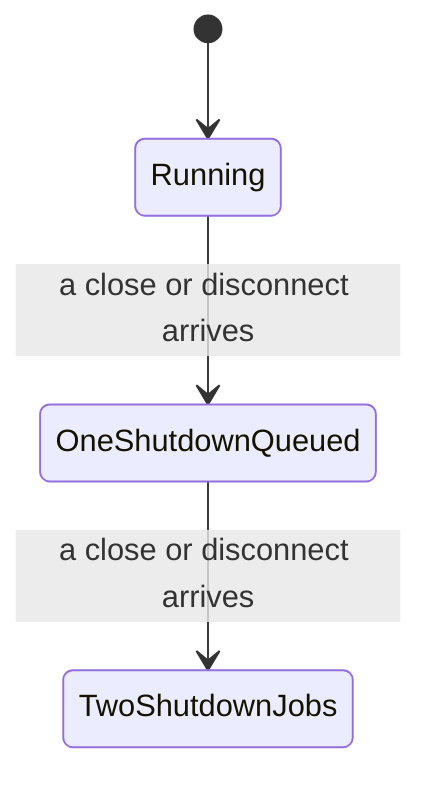

# Verification results

Checked on 2026-11-11 against product source at `528f03cc6cea4f10c1dde3f44eab2e212590b325`. No product source changes remain.

## Passing model

TLC 1.7.4, with one worker and fingerprint polynomial 0, exhausted 61 distinct states. `TypeOK`, `OneShutdownCompletion`, and the deadlock check passed. The model covers three requests to one bound Playwright context, not the whole browser lifecycle.

pstack `/statechart` at `5866df557357d005b3c0c9d3da0d9e739b4bdde3` interpreted the same model with the same TLC jar. Its chart merges 61 model states into six labels and hides 63 steps that stay within a label, including follower requests that reuse the completion. It draws every transition between labels.

```mermaid
stateDiagram-v2
  s0: Running
  s1: One shutdown queued
  s2: Requesting browser close
  s3: Releasing profile processes
  s4: Shared shutdown settled
  s5: Disconnecting Playwright
  [*] --> s0
  s0 --> s1: a close or disconnect arrives
  s1 --> s2: the shutdown microtask starts
  s2 --> s3: the browser close request returns
  s2 --> s4: shutdown returns or rejects
  s3 --> s4: shutdown returns or rejects
  s3 --> s5: profile cleanup returns
  s5 --> s4: shutdown returns or rejects
```

## Failing model

`Broken.cfg` weakens the guard so that only a settled shutdown reuses its completion. Direct TLC exits 12 and reports `Invariant OneShutdownCompletion is violated`. `/statechart` found the shortest violation in two steps and exhausted 454 states when it continued past the violation.

1. A close or disconnect queues one shutdown and returns its completion.
2. Another close or disconnect queues a second shutdown and returns another completion.

The second chart shows only the shortest counterexample, not the broken model's full graph. `TwoShutdownJobs` breaks `OneShutdownCompletion`.

## Source mutation and restoration

The scratch source replaced the guard in `bindPlaywrightOwned` with `if (state.phase === "settled") return state.completion;`. The same verification command compiled that source and failed the real Chromium test with `disconnect and close share one completion`. Its log recorded four shutdown messages for the one profile. The test's cleanup finished without a remaining-profile-process assertion failure.

After restoring the original guard, the command exited 0. The focused run reported one passing test, zero skipped tests, and one shutdown message. The existing test also checked that no processes remained for its throwaway profile. No visible browser window or installed app was used.

## Known gaps

One earlier run against unchanged source failed with `bao shutdown processes still shutting down`. An unchanged retry passed, as did the final post-restoration run. That cleanup-timing failure is outside the modeled latch property. It remains a follow-up, not a fixed defect or proof that cleanup always succeeds.

The real-browser test exercises the headless normal-launch route. The account-launch route shares the same binding function but was not run because this check must not open a visible browser window. The other bounds and assumptions are in [the coverage record](./README.md).

## Rerun

Follow [the verification skill](./SKILL.md). Its one-command check retains TLC, build, and focused-test logs in the temporary folder it prints. Use `/statechart` with [the view module](./view.mjs) to regenerate the interpreted charts. Java and checker downloads live under `/tmp/bao-formal-tools.noindex`, outside fleet state. No checker binary is committed.
