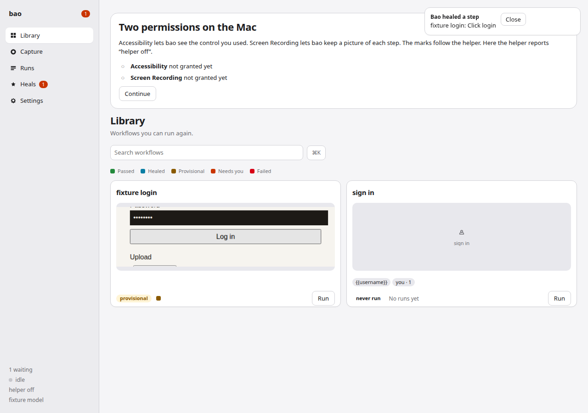
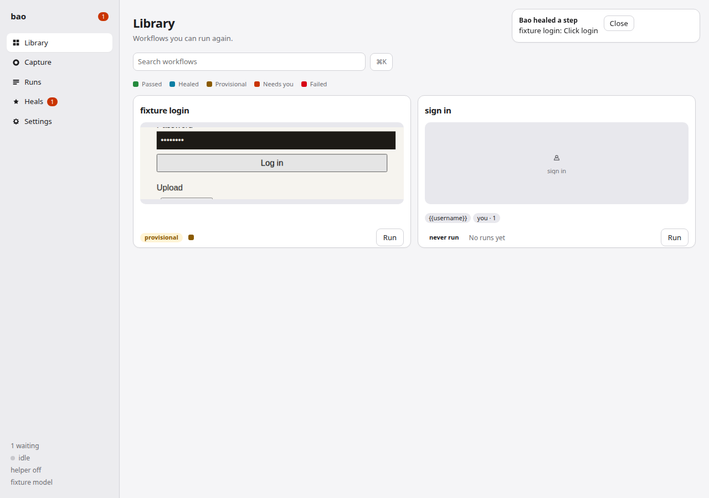
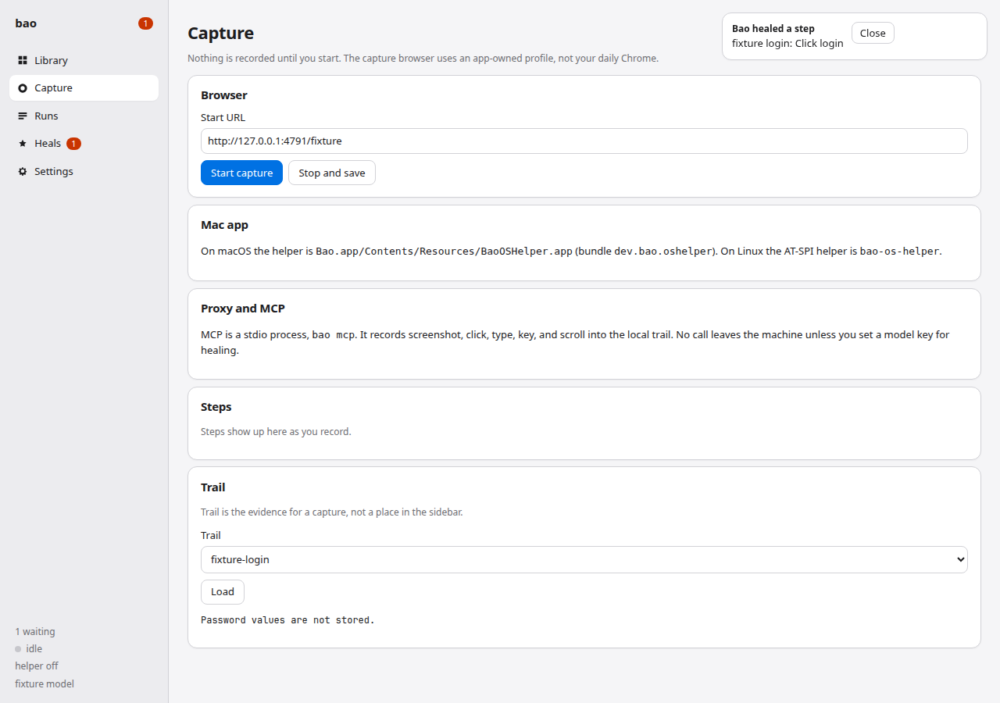
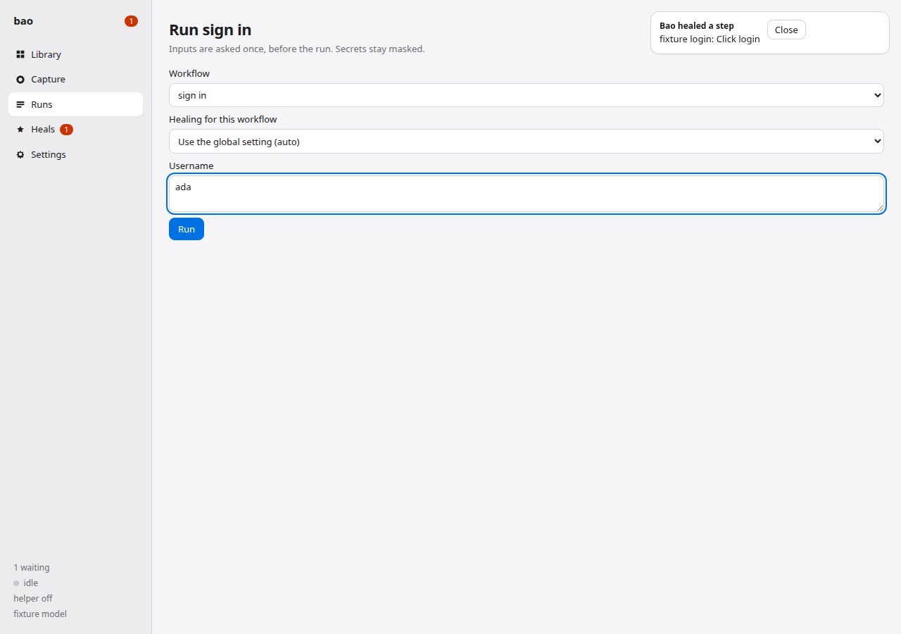
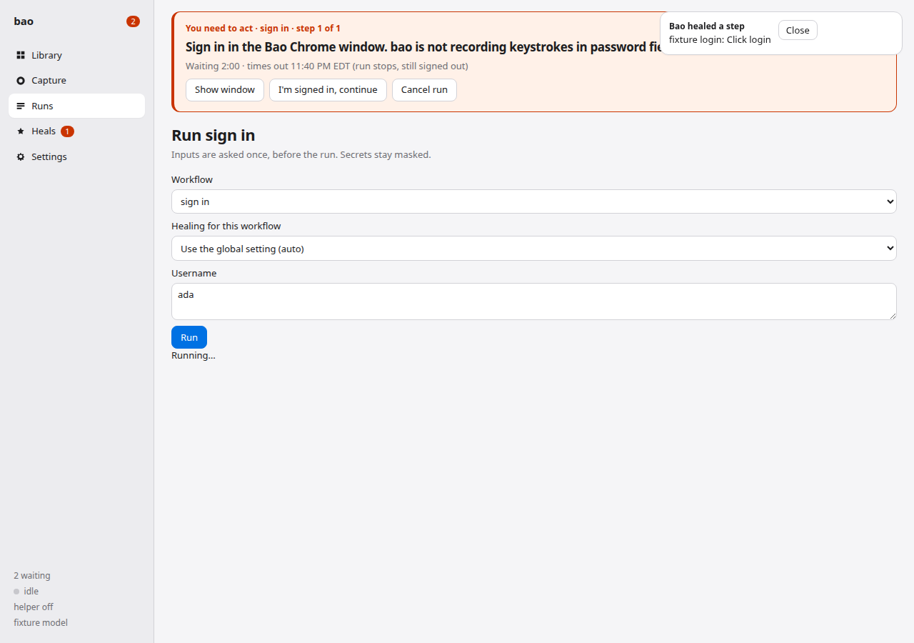
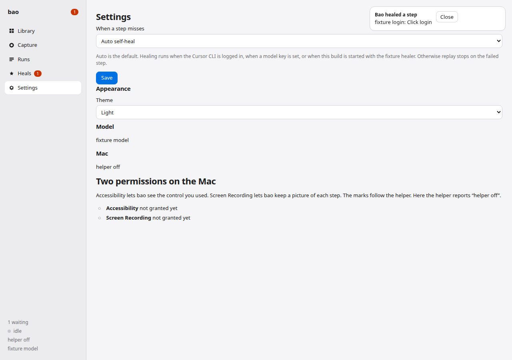
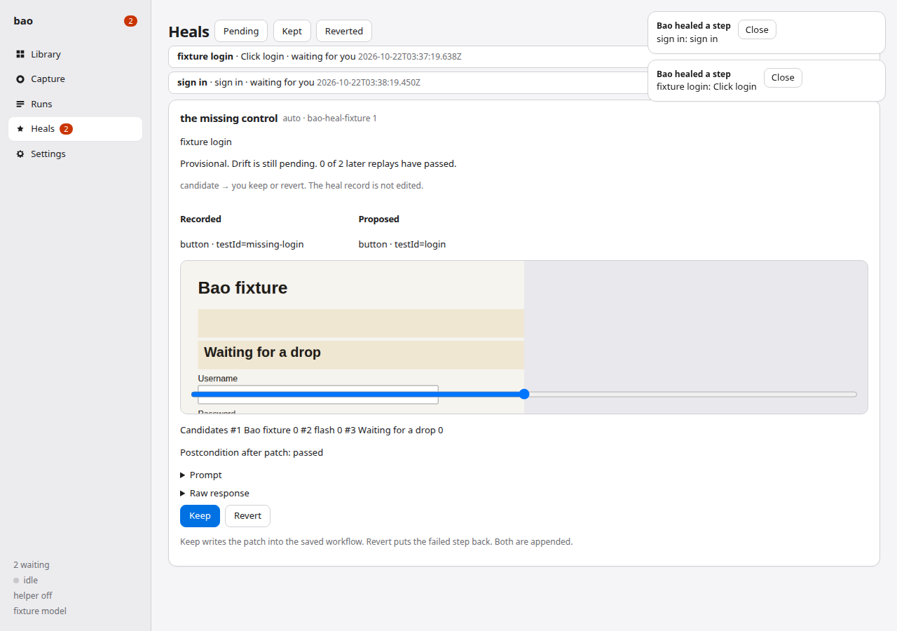

# macOS test

Follow this with a fresh `BAO_HOME` on this Mac, from an empty data directory to a saved workflow. Use the signing certificate and the helper grants already on this account. A grant on another account does not carry over.

The pictures in this file are the Bao window on the built-in fixture (`http://127.0.0.1/fixture`). They were taken where the Mac helper is absent, so the sidebar footer reads **helper off**. On your Mac, before the two grants below, Library has a collapsible permission card and the other screens have a sidebar dot. After both grants, that footer reads **helper ok** and the card and the dot are gone. The rest of the window is the same. Linux does not show the card.

Use the fixture, or a public page you are not signed into. Type a made-up username such as `ada`. Use a made-up password only if a step asks for one, and confirm afterward that the trail and the workflow file do not contain it. Do not point capture at a daily Chrome profile or at a site where you have a real session.

Build commit `6c249b9` on `v1/desktop`, or a later commit that contains this procedure. That commit has the desktop window, the floating capture bar, Chrome login import (cookies, localStorage, and IndexedDB for one site), multi-machine sync, the marketplace web app, the clean product window, the file step, and the act ask (the site host, the deadline with its zone, and Show window). Build both package scripts from this checkout.

The signed app is still two scripts, in this order, from the repo root:

```sh
desktop/os-helper-macos/package-app.sh
desktop/packaging/macos/package-app.sh
```

**What you should see:** the first script prints a signed `BaoOSHelper.app` (`dev.bao.oshelper`). The second prints a signed `Bao.app` (`dev.bao.desktop`) and a dmg. `Bao.app` contains the helper and Playwright's Chromium. No notarization step. Open `Bao.app`, and the window is the one in the pictures below: Library, Capture, Teach, Runs, Heals, Replay, Logins, and Settings.

## Prerequisites

Install these before either `package-app.sh`. Each one has a check.

### Node 24 or newer

`package.json` asks for Node `>=24`. A Finder launch does not see your shell `PATH`, so you will also need the absolute path later (`BAO_NODE`).

```sh
node -v
command -v node
```

**What you should see:** `node -v` prints `v24` or a higher major, for example `v24.19.0`. `command -v node` prints an absolute path such as `/opt/homebrew/bin/node` or a mise install under your home directory. If the version starts with `v22` or lower, install Node 24 before `npm install`. On an older Node, `npm install` prints `EBADENGINE` and the desktop compile is outside the range this repo declares.

Homebrew on Apple silicon:

```sh
brew install node@24
```

**What you should see:** `$(brew --prefix node@24)/bin/node -v` prints `v24` or higher. Use that absolute path as `BAO_NODE`.

### Google Chrome

Install Chrome from [https://www.google.com/chrome/](https://www.google.com/chrome/) if it is not already in `/Applications`.

```sh
/bin/ls -d "/Applications/Google Chrome.app"
```

**What you should see:** the command prints `/Applications/Google Chrome.app`. Use `/bin/ls`. A shell `ls` can be an alias, and a missing alias target prints nothing even when Chrome is installed.

Capture and replay open the Chromium that `package-app.sh` copies into `Bao.app` (`Contents/Resources/Chromium.app`, Playwright's Chrome for Testing). Importing a site sign-in is the step that reads the installed Google Chrome. The product window and the capture window leave that daily profile alone.

### Xcode Command Line Tools

The helper and the app need `clang`, `codesign`, and `hdiutil`.

```sh
xcode-select -p
xcrun --find clang
xcrun --find codesign
xcrun --find hdiutil
```

Run `xcode-select --install` only when `xcode-select -p` fails. When the tools are already present, `--install` can raise the system install dialog anyway.

**What you should see:** `xcode-select -p` prints `/Library/Developer/CommandLineTools` or an Xcode.app path. The three `xcrun --find` lines print absolute paths. `clang --version` names Apple clang.

### Rust, in the helper's toolchain directory

`desktop/os-helper-macos/package-app.sh` runs cargo from `~/dev/bao-mac-toolchain/cargo` unless `CARGO_HOME` is already set. If `"$HOME/dev/bao-mac-toolchain/cargo/bin/cargo" --version` already prints `cargo 1.`, skip the installer. Otherwise install rustup there before the helper build.

```sh
mkdir -p "$HOME/dev/bao-mac-toolchain"
export RUSTUP_HOME="$HOME/dev/bao-mac-toolchain/rustup"
export CARGO_HOME="$HOME/dev/bao-mac-toolchain/cargo"
curl --proto '=https' --tlsv1.2 -sSf https://sh.rustup.rs | sh -s -- -y --no-modify-path --default-toolchain stable
"$CARGO_HOME/bin/cargo" --version
```

**What you should see:** the rustup script ends with a stable toolchain installed, and `cargo --version` prints `cargo 1.` followed by a version. The script does not edit your shell rc file (`--no-modify-path`).

### Signing identity `bao dev signing`

Both package scripts sign with `BAO_SIGN_IDENTITY`, which defaults to the login-keychain certificate `bao dev signing`. A fresh account has no such certificate. Create one self-signed code-signing cert, allow `codesign` to use the key, then delete the temporary key, certificate, and p12. Trust settings stay untouched. The certificate is not added to the System keychain.

```sh
security find-certificate -c 'bao dev signing' >/dev/null && echo 'certificate present'
security find-identity -v -p codesigning | grep -F 'bao dev signing' || true
```

If the certificate is present, skip the `openssl` block. `find-identity -p codesigning` can print nothing while that certificate is in the login keychain and `codesign --sign "bao dev signing"` still works. Trust settings stay untouched, and that list only shows identities the policy accepts. Do not create a second certificate with the same common name. A new certificate is a different app, and the helper grant does not follow it.

If the certificate is absent:

```sh
WORKDIR=$(mktemp -d)
openssl req -new -newkey rsa:2048 -x509 -days 3650 -nodes \
  -subj "/CN=bao dev signing" \
  -addext "basicConstraints=critical,CA:FALSE" \
  -addext "keyUsage=critical,digitalSignature" \
  -addext "extendedKeyUsage=critical,codeSigning" \
  -keyout "$WORKDIR/key.pem" -out "$WORKDIR/cert.pem"
openssl pkcs12 -export -inkey "$WORKDIR/key.pem" -in "$WORKDIR/cert.pem" \
  -out "$WORKDIR/bao.p12" -name "bao dev signing" -passout pass:
security import "$WORKDIR/bao.p12" -P "" -T /usr/bin/codesign -f pkcs12
rm -rf "$WORKDIR"
security find-identity -v -p codesigning
```

**What you should see:** `security find-certificate -c 'bao dev signing'` succeeds, and `codesign --sign "bao dev signing"` can sign a throwaway binary. `find-identity -p codesigning` may still print nothing. Keep this certificate. The grant follows it plus the bundle id. A rebuild of the helper with that same certificate kept the same CDHash on this Mac (`e2ad7477d8f989484c3d0ef8a2598561844127bf`) and the nested helper still reported both permissions. `ls` of the temp directory fails because `rm -rf` removed the key, the cert, and the p12.

There is no notarization step.

### This checkout

This procedure was checked at `6c249b9` on `v1/desktop`. `0a3276f` is an older pin. Check out `v1/desktop` at `6c249b9` or a descendant that contains this file.

```sh
git clone https://github.com/aaalexliu/bao-browser.git
cd bao-browser
git fetch origin v1/desktop
git checkout v1/desktop
git merge-base --is-ancestor 6c249b9 HEAD
git rev-parse --short HEAD
```

**What you should see:** `git merge-base --is-ancestor 6c249b9 HEAD` exits 0. `git rev-parse --short HEAD` prints `6c249b9` or a later commit on `v1/desktop`. `test -f docs/mac-test.md && test -f desktop/packaging/macos/package-app.sh && test -f desktop/src/login-import/import-login.ts && test -f desktop/src/v1/sync.ts && test -f web/package.json` exits 0.

## Build

```sh
npm install
export BAO_SIGN_IDENTITY="${BAO_SIGN_IDENTITY:-bao dev signing}"
export BAO_NODE="$(command -v node)"
case "$BAO_NODE" in
  /*) ;;
  *) echo "BAO_NODE must be an absolute path"; exit 1 ;;
esac
export RUSTUP_HOME="${RUSTUP_HOME:-$HOME/dev/bao-mac-toolchain/rustup}"
export CARGO_HOME="${CARGO_HOME:-$HOME/dev/bao-mac-toolchain/cargo}"
bash desktop/os-helper-macos/package-app.sh
bash desktop/packaging/macos/package-app.sh
file desktop/packaging/macos/dist/Bao.app/Contents/MacOS/bao
```

`npm install` finishes before the desktop script runs `tsc`. The helper script builds `desktop/os-helper-macos/BaoOSHelper.app` (`dev.bao.oshelper`) and signs it with the runtime flag. The desktop script compiles `desktop/packaging/macos/bao-main.c` into `Bao.app` (`dev.bao.desktop`), copies the helper to `Bao.app/Contents/Resources/BaoOSHelper.app`, copies `src/mask.ts` to `Contents/Resources/bao/src/mask.ts` (the window script imports it; without that file `/app.js` is a 500 and the sidebar never renders), copies Playwright Chromium to `Contents/Resources/Chromium.app`, and writes `Bao.dmg` beside the app.

**What you should see:**

- `npm install` ends without `EBADENGINE`.
- The helper script's `codesign --verify` prints `valid on disk` and `satisfies its Designated Requirement`.
- The desktop script prints `BUNDLED_BROWSER` and then `WROTE` lines for `Bao.app` and `Bao.dmg`.
- `file` prints `Mach-O 64-bit executable arm64` for `Contents/MacOS/bao`.

## First open (Gatekeeper)

The app is signed with a self-signed certificate. Gatekeeper shows its sheets when the app has the quarantine attribute, which a downloaded copy has. A local `package-app.sh` build does not: `xattr` on `Bao.app` has no `com.apple.quarantine`, and Finder Open does not show those sheets.

When the app is quarantined, Finder shows two sheets. The first says `"Bao.app" cannot be opened because the developer cannot be verified.` The confirmation says `macOS cannot verify the developer of "Bao.app". Are you sure you want to open it?` Those sheets are macOS. They are quoted here.

Do not use that Finder launch for this test when `~/Library/Application Support/bao` or port `4787` is already in use. Finder starts the default home and the default port. Quit a Finder launch if one appeared, then use the Terminal launch below so `BAO_NODE` and `BAO_HOME` are set.

## Launch from Terminal

A Finder launch uses a short `PATH` and the default data directory `~/Library/Application Support/bao`. Launch from Terminal on a fresh account. Use a throwaway home so this test does not read or write anything already in the default directory.

`4787` is the app default and may already belong to another Bao. This test uses `4807`.

```sh
export BAO_HOME="$HOME/Library/Application Support/bao-mac-test"
export BAO_PORT=4807
export BAO_NODE="$(command -v node)"
# This path is the throwaway home, not ~/Library/Application Support/bao.
# mkdir -p does not empty a previous run. Remove it first when it already has files.
rm -rf "$BAO_HOME"
mkdir -p "$BAO_HOME"
desktop/packaging/macos/dist/Bao.app/Contents/MacOS/bao
```

The entry point sets `BAO_HEADED=1` when it is unset, points `BAO_BROWSER` at `Contents/Resources/Chromium.app`, and points `BAO_OS_HELPER` at the nested `BaoOSHelper.app`. Leave this Terminal process running. Do not `open` the app again while it is running. LaunchServices would start a second instance on the default home.

**What you should see:** a window opens on `http://127.0.0.1:4807`. It is app mode: no address bar, no tab strip, and no Chrome for Testing infobar (`--disable-infobars`). The page does not ask to show notifications. The first screen is Library, with an empty library on a fresh home. The capture panel is not on screen yet. There is no act sentence, no Dock badge, and no notification prompt at idle. The sidebar lists Library, Capture, Teach, Runs, Heals, Replay, Logins, and Settings. The pictures below were taken before Teach, Replay, and Logins were on the rail, and before the permission card was limited to macOS. The build includes those screens. On a Mac that has not granted the helper yet, Library shows a collapsed row, **Two permissions on the Mac**. Open it for Accessibility and Screen Recording. The footer reads **helper needs permission**. Continue dismisses that card. Logins, Settings, and the other screens do not repeat it. While a grant is still missing they show a dot beside the footer label; open the dot for the same two rows. When both are granted, the card and the dot are gone and the footer reads **helper ok**. Linux shows neither, and the footer reads **helper off**. The picture is the earlier card on a machine with no Mac helper.



In another Terminal:

```sh
ps aux | grep -F 'Bao.app/Contents/Resources/Chromium.app'
curl -s "http://127.0.0.1:${BAO_PORT}/api/pids"
```

**What you should see:** the process list includes `Bao.app/Contents/Resources/Chromium.app`. `curl` prints JSON whose `helper` path ends in `Bao.app/Contents/Resources/BaoOSHelper.app`.

## Permissions

The product window does not need Accessibility. The nested helper does. On the first launch, macOS asks twice:

1. Accessibility. The usage string is `BaoOSHelper reads accessibility elements in throwaway apps so a computer-use click can be replayed by role and name.` The sheet asks to allow BaoOSHelper to control the computer.
2. Screen Recording. The usage string is `BaoOSHelper captures one throwaway window so the spike can show the control it pressed.` The sheet asks to allow BaoOSHelper to record the screen.

**What you should see:** those two sheets, in that order, naming **BaoOSHelper**. Enable BaoOSHelper in System Settings → Privacy & Security → Accessibility, and again under Screen & System Audio Recording (the Screen Recording list). Add `Bao.app/Contents/Resources/BaoOSHelper.app` with the + button if the row is missing. The grant is for bundle id `dev.bao.oshelper` signed by your `bao dev signing` certificate. A rebuild with that same certificate keeps the grant. A new certificate, or an ad-hoc signature, is a different app and the grant does not follow it. Do not pass `--prompt` after the rows are on.

Quit Bao (Ctrl-C in the launch Terminal) and launch it again with the same `BAO_HOME`, `BAO_PORT`, and `BAO_NODE`.

**What you should see:** no new privacy sheet. The sidebar footer reads **helper ok**. The permission card and the sidebar dot are gone, because both grants are present. Library is the main page. The picture of Library below was taken with the footer still **helper off**.



`curl -s "http://127.0.0.1:${BAO_PORT}/api/state"` reports `helper.accessibility` true, `helper.screenCapture` true, and `helper.label` equal to `helper ok`.

## Record on the fixture

Click **Capture** in the sidebar.

**What you should see:** Start URL is already the fixture on this server (`http://127.0.0.1:4807/fixture`). The page says nothing is recorded until you start, and that the capture browser uses an app-owned profile. The Mac app card names `Bao.app/Contents/Resources/BaoOSHelper.app` and bundle `dev.bao.oshelper`.



1. Press **Start capture**. A second window opens on the fixture. That window is the bundled Chromium. The floating Bao Capture panel lists each step as it lands. Pause drops further UI events. Add note and Add check append a note or a check. Discard throws the take away. Control-option-command R starts, period stops, and P pauses. A password field is blurred before a screenshot is taken. A login or confirm wait shows the ask and the site in red on the Bao Capture panel, with the time left and **Show window**. `Bao.app` sets its Dock badge to `!` and posts the notification with `UNUserNotificationCenter`.
2. Type `ada` in Username. Type a made-up password in Password. Click **Log in**. The fixture shows `Welcome` plus the username.
3. Choose a throwaway file in the file input, for example a text file you created under `/tmp` for this test. Capture intercepts the chooser, records a `file` input, and forwards the chosen path so the page shows the file name.
4. Drag a throwaway file from Finder onto **Drop a file here** or the file input. The page records that drop as one `file` input named `file`, value `{{file}}`. A following change event from the same drop is not a second step.
5. Press **Stop and save**.

The drag has to be a real file drop. A scripted pointer move does not start an `NSDraggingSession`, and the helper's `drag-file` command still reports that it cannot offer the file. The proof is a throwaway file dragged from a throwaway Finder window, or a small source window that begins the dragging session while the already-granted helper moves the pointer. Do not rebuild the helper to do it, and do not request a permission.

**What you should see:** Library gains a card for the capture. Open the workflow. It has a `secret` input. The chooser and the drag each add a `file` input. A capture that stopped after Log in has the secret and the click, and no file input. The secret string is absent. The absolute path of the file is absent. The trail view says `Password values are not stored.` The saved `startUrl` is the page URL at stop time. The fixture's Log in button uses `pushState` to `/secure`, and this server serves the fixture HTML there too, so a capture that continued through the file step saves `http://127.0.0.1:4807/secure`. On any other site, stop on the page replay should open.

## Replay twice, with inputs

On the Library card, press **Run** (the button on the card, under the status). The run form lists every input before the run starts. Secrets are password fields. The username you type here is the value for this run.

**What you should see:** the heading is `Run` plus the workflow name. Healing for this workflow offers the global setting, auto, or approve. Auto is the default. A Username field is empty until you type. The picture uses the made-up name `ada`.



Press **Run**. Fill a different username and a different file than the capture. Replay sets a file input with `DOM.setFileInputFiles`, and a drop zone with a synthetic `DataTransfer` of the new file. The run form asks for the file. The saved workflow has no absolute path. Run again after you move and resize the replay window. The next run reuses that window, and the bounds are stored per workflow. Chrome for Testing is moved with CDP `Browser.setWindowBounds`, and that origin and size are what the next run keeps. The helper is also tried with the replay pid. A size row can stay `n/a-harness` when `AXSize` is rejected (`-25200`). A step failure counts only after the requested bounds landed.

Each headed replay writes `videos/<runId>.webm` and the run page plays it from `/api/runs/<runId>/video`. On macOS the picture is only that replay's window: a ScreenCaptureKit filter on the window (`SCContentFilter` desktop-independent window), not a display crop. A computer-use replay records the window that replay is driving, the same way. The run stores `video` and `videoStartedAt`, which is what shows the player.

**What you should see:** each step goes pass or fail in Runs. The fixture page shows `Welcome` plus the username you typed, and the file name you supplied. The press log has no x,y.

### Login act bar

The fixture capture above records Type, Type secret, and Click Log in. It does not record a step whose action is `login`, so Library after only that capture does not show this bar. This section is a different workflow.

A step whose action is `login` waits for you. Replay does not type the password and does not press Log in. The bar sits above the page you were on.

**What you should see:** a bar labeled `You need to act`, the workflow name, and the instruction `Sign in to 127.0.0.1 in the Bao window`. The host comes from the workflow's start URL. The words `the site` appear only when that URL has no host. Buttons are **I'm signed in, continue**, **Show window**, and **Cancel run**. The sidebar shows a waiting count. Sign in on the fixture window with `ada` and a made-up password, then press **I'm signed in, continue**. The picture is that bar on the run form.

The same wait also orders the Bao Capture panel forward. The red line is first, above the notifications row. It is that instruction, then the time left and the local clock with its zone, and **Show window**. `Bao.app` posts that sentence with `UNUserNotificationCenter` (category `bao.act`, action **Show window**). The notification title, body, and the app's help text are the same string. The Dock badge on Bao's tile is `!`. The hover label on the tile stays Bao. `osascript` is not used, and BaoOSHelper does not post the notification. The first post asks once, with the system prompt that Bao would like to send notifications, when authorization is not determined yet. Leave that prompt. When notifications are already denied, there is no prompt. The panel shows **Notifications are off for Bao** and **Open Settings**, which opens the Notifications pane. Do not click **Open Settings** while you are only checking the row.



A confirm step uses the same bar. On the fixture the instruction is `Press Apply on 127.0.0.1 in the Bao window`. Replay does not press Apply.

## Heal review

Settings → When a step misses defaults to **Auto self-heal**. With the Cursor CLI logged in (`agent login`), the footer reads **cursor account** and a miss calls `agent --print` on your Cursor plan. bao does not ask you to paste an API key. `BAO_HEAL_CURSOR=1` is the file handoff (`heal-request.json` / `heal-response.json`) when the CLI is missing or logged out. `BAO_HEAL_CURSOR_ACCOUNT=0` skips the CLI. `BAO_HEAL_FIXTURE=1` is a local stand-in whose model name is `bao-heal-fixture`. The pictures use that stand-in. It is the way to see a heal review on a machine with no Cursor login. It is not the billed path.

The fixture capture in Record does not miss, so Heals stays empty after those two replays. That empty screen is the passing result. A row appears when a step fails. The pictures are that failure with `BAO_HEAL_FIXTURE=1`. Do not cause a miss while Model reads **cursor account**. Auto self-heal would call the Cursor CLI. The row steps below are only for that failure.

**What you should see:** Settings shows When a step misses on Auto self-heal, Model **fixture model** while `BAO_HEAL_FIXTURE=1` is set, and the quiet paragraph names the Cursor CLI. On your Mac, after `agent login` and with the fixture flag unset, Model reads **cursor account**. With neither a login nor a key nor `BAO_HEAL_CURSOR`, Model reads **no model** and replay stops on the failed step. The launch block above does not set `BAO_HEAL_FIXTURE`.



Open **Heals**. A row names the workflow, the step, and whether it is waiting for you. Open the row.

**What you should see:** the detail shows the workflow name, Recorded next to Proposed, the model `bao-heal-fixture 1` when the fixture healer ran, the postcondition line, and **Keep** / **Revert**. Keep writes the patch into the saved workflow. Revert puts the failed step back. The heal record itself is not edited. In the picture, Recorded is `testId=missing-login` and Proposed is `testId=login`.



A login redirect (phase `auth`) is not sent to a model. The act bar above is the path for that wait.

## Optional: Calculator

Skip this until `BaoOSHelper` reports both permissions true and an accessibility walk of Calculator contains the keypad buttons (`7`, `Add`, `5`, `Equals`). The walk has to include those buttons. A hit-test that sees them while the tree does not is not enough for replay. `AXSize` is still rejected (`-25200`), so a resize row can stay `n/a-harness` while the steps pass. Quit Calculator when you are done. Do not leave a real document open in TextEdit. A throwaway `note.txt` under `/tmp` is the file to use if you try a type step.

## Done

You have Node 24 or newer, Google Chrome in `/Applications`, the command line tools, cargo in `~/dev/bao-mac-toolchain`, the login-keychain certificate `bao dev signing` (even when `find-identity -p codesigning` prints nothing), Accessibility and Screen Recording for the nested `BaoOSHelper.app`, a fixture capture with a secret input, a file input after the chooser and the Finder drag, and two replays with different inputs. The login act bar is a workflow whose step action is `login`, and its instruction names the site host. A heal review appears when a step misses. The secret string and the file path are absent from the saved workflow.
